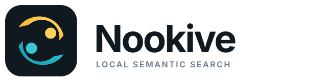

# Nookive

<p align="center">
  
</p>

**Describe it. Find it.**

<p align="center">
  
</p>

Maintained by [Croni](https://github.com/team-croni). Source code and releases
are hosted at [team-croni/Nookive](https://github.com/team-croni/Nookive).

This is an open-source project for macOS. It is not distributed through the
Apple App Store and release builds are not Apple-notarized.

[Download Nookive for macOS (Apple Silicon)](https://github.com/team-croni/Nookive/releases) · [View all releases](https://github.com/team-croni/Nookive/releases)

Nookive is an open-source, on-device semantic search app for macOS. Search
your documents, images, recordings, and videos by describing what you
remember instead of guessing a filename. Nookive runs the embedding pipeline
locally with EmbeddingGemma 2 and llama.cpp.

> Your indexed content stays on your Mac. Nookive does not require an account
> or a hosted AI service. Model downloads and Google autocomplete/web-search
> actions are network operations; they are separate from local indexing.

## What it can find

- Semantic matches such as “the clause about pets in the lease” or “payment
  declined screenshot”.
- PDF pages and Markdown/text files. Code and configuration files are left out
  of semantic search (see code search below); credential files are never read.
- Code in your search folders by file name, path, or contents, with the
  matching line: press Tab or type `code:` in the search window. Results open
  at that line in your editor (VS Code, Cursor, Zed, Sublime Text, JetBrains
  IDEs, or Xcode). You can turn this off in Settings.
- Images by visual content, with macOS Vision labels/OCR where available.
- Audio and video by content, with results pointing to a relevant time range.
- Installed macOS applications by localized name, original name, or bundle
  identifier.
- Exact terms and filenames alongside semantic ranking.

PDF results are scanned in the background so a result can show the page where
the query was found before it is opened. When a PDF is opened, Nookive picks
the page that contains the most query words (ignoring one-letter words and
stopwords such as "how" or "did") when the document has a readable text layer,
highlights the matching text, and shows the current page and total page count.
When pages tie, the page that search ranked highest wins. PDF scan results are
cached for the same document, query, and page.

On macOS, PDF pages can be rendered through the native Core Graphics renderer.
Documents without a usable text layer can still be previewed, but they may
not have a matching page or text highlight.

## Status and platform

Nookive is an early-stage macOS desktop application. The current build targets
Apple Silicon and macOS 14 or later. Windows and Linux are not supported yet.
Audio transcription and forced alignment are optional components and may have
additional model or platform requirements.

## Install a release

Download the latest macOS Apple Silicon DMG from [GitHub Releases](https://github.com/team-croni/Nookive/releases), open the DMG,
and move Nookive to Applications. Until Apple Developer signing and
notarization are added, a downloaded release may show a macOS security warning;
users may need to use Control-click → Open or approve it in Privacy & Security.
On first launch, Nookive opens the in-app installer when the required search
model is missing. The search and speech model bundles are downloaded
separately: the search model is required for semantic search, while the speech
bundle is optional and enables transcription and word-level timestamps for
audio/video indexing. No terminal command is needed. Models are stored in
macOS Application Support and remain on your Mac.
The source repository and DMG exclude model weights; check the release notes
and [third-party notices](THIRD_PARTY_NOTICES.md) before redistribution.

Nookive runs as a macOS menu-bar utility. It stays available from the menu bar
and global shortcut without appearing in the Dock or the `Cmd + Tab` app switcher.

## Build from source

Requirements: macOS on Apple Silicon, Node.js 20.19+ (or 22.12+), Rust, Xcode/Swift toolchain,
and the Tauri prerequisites.

```sh
npm ci
npm run build
npm run lint
npm run desktop
```

For local semantic indexing, download the model files first:

```sh
npm run model:download
```

Optional media and speech helpers are prepared with:

```sh
npm run media:build
npm run asr:download
npm run aligner:build
```

The exact script names available in this checkout can be listed with
`npm run`. A production DMG is built with:

```sh
npm run tauri -- build --bundles dmg
```

The bundle preparation step expects the helper binaries to be present. It also
generates `bin/licenses/THIRD_PARTY_LICENSES.txt`, the full license texts of
every third-party component shipped in the app, and fails if a native
component's license is missing. Run `npm run licenses` to generate it during
development. Models are intentionally downloaded after installation rather
than committed to this repository or embedded in the DMG; see
`THIRD_PARTY_NOTICES.md`.

The DMG intentionally contains no model weights. On first launch, the app
downloads and verifies the model components required by the installer. Model
downloads can be stopped, paused, resumed, or reset from the installer window
and menu-bar tray menu.

### File access on macOS

Nookive follows macOS file-access permissions. If a selected file or PDF
cannot be opened, grant the app access to the folder containing it and restart
the app if necessary. The supported user-folder scopes include:

- `~/Documents`
- `~/Desktop`
- `~/Downloads`
- `~/Pictures`

## Environment variables

No `.env` file is required. Nookive is a local desktop app rather than a web
service, so runtime settings are passed as ordinary process environment
variables when needed. Copying `.env.example` is optional and does not add any
secrets. Supported tuning variables include `NOOKIVE_PORT`, `NOOKIVE_CPU_ONLY`,
`NOOKIVE_ALLOW_CPU_FALLBACK`, `NOOKIVE_CTX_SIZE`, `NOOKIVE_BATCH_SIZE`,
`NOOKIVE_UBATCH_SIZE`, `NOOKIVE_PARALLEL`, and `NOOKIVE_ASR_PORT`.

Never put API keys, signing credentials, Apple notarization passwords, or
personal file paths in a committed environment file. Use your shell, macOS
Keychain, or CI secret storage for those values.

## Privacy and data handling

Nookive reads file contents only from folders selected by the user and stores
its local index in the application data directory. It also scans the standard
macOS application folders for installed app names and bundle identifiers; app
bundle contents are not indexed. To rank results you open a little higher
next time, Nookive keeps your search words and the opened paths in the
application data directory; reset them under Settings → Search
personalization. Nookive does not upload indexed file contents. If you use autocomplete or web search, the typed query and the app
language are sent to Google and the selected URL is opened in your browser. The temporary
embedding server listens on loopback (`127.0.0.1`) and should not be exposed
publicly. Local indexes, logs, model caches, and selected paths may be
sensitive and should be handled accordingly.

## Documentation

- [System architecture](docs/system-architecture.md)
- [Indexer pipeline](docs/indexer-pipeline.md)
- [Settings and menu bar](docs/settings-and-menu-bar.md)
- [Documentation index](docs/README.md)
- [Open-source release checklist](docs/release-checklist.md)
- [Third-party notices](THIRD_PARTY_NOTICES.md)

## Contributing and security

See [CONTRIBUTING.md](CONTRIBUTING.md) for development conventions and
[SECURITY.md](SECURITY.md) for private vulnerability reporting.

## Acknowledgements

Nookive is built with Tauri, React, Vite, llama.cpp, EmbeddingGemma 2, and
other open-source components. Their licenses and upstream links are listed in
[THIRD_PARTY_NOTICES.md](THIRD_PARTY_NOTICES.md). Nookive is not affiliated
with Google or Apple. EmbeddingGemma/Gemma, macOS, and Apple are trademarks of
their respective owners.

The demo above uses made-up documents and recordings created by
[`scripts/demo`](scripts/demo/README.md). The photos come from
[Crossmodal-3600](https://google.github.io/crossmodal-3600/) and are licensed
under [CC BY 2.0](https://creativecommons.org/licenses/by/2.0/):
[sunset over the sea](https://www.flickr.com/photos/mckaysavage/7012759923)
by McKay Savage and
[evening beach](https://www.flickr.com/photos/eager/5686015449/) by
準建築人手札網站 Forgemind ArchiMedia.

## License

Nookive's original source code is available under the [MIT License](LICENSE).
Third-party components and downloaded model files remain under their own terms.
The app includes their full license texts under Settings → About →
Open-source licenses.
