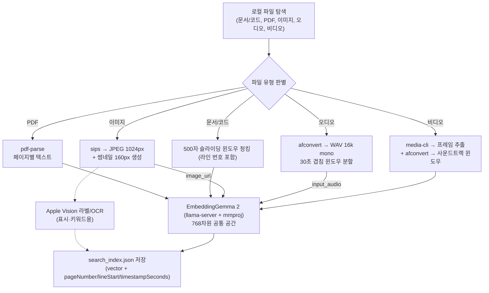

# Local Indexer & Embedding Pipeline

## 1. 개요 (Overview)

로컬 파일(문서/코드, PDF, 이미지, 오디오, 비디오)을 읽어와 **내용 추출 → 청크/세그먼트 분할 → 멀티모달 EmbeddingGemma 2 추론 → 하이브리드 랭킹**으로 이어지는 온디바이스 색인 명세입니다.

EmbeddingGemma 2는 **텍스트·이미지·오디오를 하나의 768차원 공간**에 임베딩합니다. 따라서 이미지 "내용", 오디오/영상의 "그 순간"을 텍스트 쿼리로 통합 검색할 수 있습니다(DigUp 방식).

---

## 2. 네이티브 바이너리 및 실행 체계

- **텍스트/이미지/오디오 임베딩 바이너리**: `bin/llama-server` (Apple Silicon Metal GPU, v0.6.0)
  - **멀티모달 프로젝터(mmproj)** 필수: `models/mmproj-embeddinggemma-2-Q8_0.gguf`
- **이미지 비전 바이너리**: `bin/vision-cli` (Apple Vision 사물 분류 + OCR — 텍스트 태그/키워드 보강용)
- **비디오 프레임 추출 바이너리**: `bin/media-cli` (AVFoundation `AVAssetImageGenerator` — Swift, 신규)
- **오디오/사운드 변환**: macOS 내장 `afconvert` (16kHz mono WAV)
- **이미지 전처리**: macOS 내장 `sips` (JPEG 1024px — mtmd가 확실히 읽도록)
- **파생 이미지 생성**: macOS 내장 `sips` (목록 160px + 미리보기 720px → `~/Library/Caches/nookive/thumbnails/`)
- **개발 환경 모델 다운로드**: `npm run model:download` (`scripts/download-model.sh`) — 텍스트(310MB) + mmproj(555MB). 설치본은 첫 실행 시 앱 UI에서 Application Support로 자동 다운로드한다.
- **사이드카 가동**: `npm run sidecar` (`scripts/run-sidecar.sh` → http://127.0.0.1:8080, `--mmproj -c 2048 -b 1024 -ub 1024 -np 1`)
- **media-cli 빌드**: `bash scripts/build-media-cli.sh`
- **파일 색인 실행**: `npm run index -- [디렉토리경로]` (기본값: `npm run index:sample`)

### 2.1 macOS 애플리케이션 인덱스

앱은 DigUp의 파일 내용 인덱스와 구분한다. DigUp README도 앱 번들을 읽지 않고 앱/캐시/비밀 파일을 제외한다고 명시한다.
Nookive는 Tauri 시작 시 `/Applications`, `/System/Applications`, `~/Applications`를 스캔해 `.app`의
`CFBundleDisplayName`과 `CFBundleIdentifier`만 검색 레코드로 만든다. 이 레코드는 EmbeddingGemma 벡터가
없으며 이름·Bundle ID 기반 exact/lexical 검색만 수행한다. 선택하면 기존 `open_file` command로 앱 번들을 실행한다.

이 분리는 앱 실행 검색에 불필요한 수백 MB의 번들 리소스 임베딩을 피하고, 설치/삭제를 다음 앱 시작 시 즉시
반영하기 위한 것이다. 향후 파일 인덱스를 JSON에서 SQLite로 옮길 때도 `items.kind = 'application'`인
메타데이터 테이블로 유지한다.

### 2.2 자동 변경 감지

등록된 검색 폴더는 Rust의 `notify` 워처로 감시한다. 파일 생성/수정/삭제가 감지되면
2초 디바운스 후 manifest를 다시 동기화하고, pending 파일을 백그라운드에서 자동으로
색인한다. 자동 색인이 끝나면 `index-updated` 이벤트로 검색 창이 인덱스를 새로고침한다.
설정 창을 열지 않아도 새 파일이 검색에 반영된다.

### 2.3 1차 증분 인덱싱 기반

현재 구현은 사용자 승인 없이 임의의 Documents/Downloads를 읽지 않도록 루트 선택을 IPC로 받는다.
`sync_index_manifest(roots)`는 선택된 루트의 지원 파일에 대해 `path + sizeBytes + modifiedAtMs` fingerprint만
수집하고, 새 파일·변경 파일을 `pending_paths`로 기록한다. manifest는 Tauri의 사용자별 app data 디렉터리
`index-manifest.json`에 임시 파일 교체 방식으로 저장한다.

검색 결과의 기존 JSON 벡터를 깨뜨리지 않도록 사용자별 runtime 인덱스를 별도로 사용한다. 설정 화면의
`지금 색인`이 `pending_paths`를 소비하며, 파일 삭제는 다음 동기화에서 현재 목록에서 제거된다.

### 2.3 텍스트/코드 증분 worker

설정 창에서 폴더를 추가하면 `indexingWorker.ts`가 pending 중 텍스트/코드 파일을 우선 처리한다.
500자 청크(50자 overlap)를 만들고, 각 청크를 로컬 `llama-server`의 `/v1/embeddings`에 보내 768차원 벡터를
사용자별 `runtime-index.json`에 atomic replace 방식으로 저장한다. 성공한 파일만 manifest에서 `ready`로 바뀌며,
서버가 꺼져 있거나 파일을 읽지 못하면 pending을 유지한다.

텍스트 worker가 이미지·PDF·오디오·비디오를 직접 처리하지는 않지만, 이 파일들은 더 이상 막혀 있지 않다.
설정 화면은 해당 pending 목록을 Tauri의 `index_pending_media` 명령으로 넘기고, 이 명령이 기존
`scripts/index-folder.mjs`를 선택 파일에 한정해 실행한다. 따라서 이미지·오디오는 mmproj 멀티모달 임베딩,
비디오는 프레임+사운드트랙 임베딩, PDF는 페이지 텍스트 임베딩으로 동일한 runtime 인덱스에 저장된다.

여기서 말한 reader worker는 별도의 현재 구현 파일 이름이 아니라, 파일 형식별로 내용을 읽고 위치 메타데이터를
만드는 처리 계층을 뜻한다. 현재 구현에서는 Node 인덱서가 이 역할까지 겸하며, 향후 SQLite/백그라운드 큐로
분리할 때 독립 worker로 추출할 수 있다.

---

## 3. 파이프라인 단계

### 3.1. 이미지 — 네이티브 이미지 임베딩

- `sips -s format jpeg -Z 1024`로 전처리 후, OpenAI 호환 content 파트 `{type:"image_url"}`로 **이미지 자체를 임베딩**.
- Apple Vision(`bin/vision-cli`)의 사물 라벨/OCR 결과는 `textSnippet`으로 저장 → **표시 및 렉시컬(정확 단어) 매칭**에 사용.
- DigUp처럼 "개 사진", "결제 실패 스크린샷" 등 **내용으로 이미지 검색**.
- **파생 이미지(캐시)**: 원본(수 MB, 12MP)을 목록/미리보기에서 그대로 로드하면 매번 대용량 디코딩으로 렉이 걸린다. 인덱싱 시점에 두 크기를 미리 생성해 인덱스에 **절대 경로**를 기록한다.
  - **목록 썸네일**: `sips -Z 160` → `file.thumbnail` (34px 표시, 원본 대비 약 300배 축소)
  - **미리보기 이미지**: `sips -Z 720` → `file.preview` (뷰포트 ~460×240, 레티나 대응, 원본 대비 약 47배 축소)
  - **저장 위치**: 프로젝트/앱 번들이 아니라 **OS 캐시 디렉터리** `~/Library/Caches/nookive/thumbnails/` → 컴퓨터 전체를 색인해도 저장소가 오염되지 않는다.
  - **콘텐츠 주소 지정**: 파일명 = `sha1(경로|수정시각|크기)_t|_p.jpg`. 파일이 바뀌면 새로 생성, 그대로면 재사용 → 재색인해도 중복 파일이 쌓이지 않는다.
  - **용량 상한(LRU)**: 캐시가 500MB를 넘으면 오래된(접근 시각 기준) 파일부터 제거 → 무한 증가 방지.
  - 프론트엔드는 `getFileSrc(file.thumbnail | file.preview)`(asset 프로토콜)로 로드하며, 없으면 원본으로 폴백한다.

### 3.2. 오디오 — 5초 겹침 윈도우 + 선택적 STT

- `afconvert -f WAVE -d LEI16@16000 -c 1`로 변환 → **5초 창, 2.5초 스텝(50% 겹침)**으로 PCM 분할.
  - `NOOKIVE_AUDIO_WINDOW_SEC`, `NOOKIVE_AUDIO_STEP_SEC`로 조정 가능.
  - 5초 윈도우는 검색 결과 뱃지가 실제 내용 구간을 2.5초 단위로 가리키게 한다.
  - 3초 이하로 줄이면 Qwen3-ASR 전사 품질이 떨어지므로 5초를 하한으로 둔다.
  - **단어 단위 타임스탬프**: `bin/qwen3-asr-cli` + `models/asr/qwen3-forced-aligner-0.6b-q8_0.gguf`로 각 윈도우의 전사 텍스트를 정렬한다. 검색 결과 뱃지는 쿼리 키워드와 일치하는 단어의 시작 시각(예: `bread` → 0:02.96)을 사용한다.
  - ForcedAligner 준비: `npm run aligner:build` (qwen3-asr.cpp 빌드 + 모델/한국어 사전 다운로드).
  - `NOOKIVE_ALIGNER=0`으로 정렬을 끌 수 있다. 정렬이 없으면 윈도우 시작 시각(2.5초 단위)을 사용한다.
- 무음 윈도우(RMS < 0.002)는 벡터를 만들지 않는다.
- 각 윈도우를 `{type:"input_audio", format:"wav"}`로 임베딩하고 `timestampSeconds`(윈도우 시작) 기록.
- **선택적 STT**: `NOOKIVE_ASR_URL`이 설정되어 있으면 같은 윈도우를 Qwen3-ASR-0.6B로 전사한다.
  - 전사 텍스트는 `bestChunk.transcript`에 저장하고, 별도 `textVector`(768차원)로 임베딩한다.
  - 검색은 `max(오디오 벡터 유사도, 전사 텍스트 벡터 유사도)` + 키워드 coverage의 3-way 하이브리드로 동작한다.
  - ASR 서버가 없거나 실패하면 전사만 건너뛰고 오디오 벡터 검색은 그대로 유지된다.
  - ASR 서버: `npm run asr` (Qwen3-ASR-0.6B Q8_0, 포트 8081). 모델: `npm run asr:download`.
  - 설정 창의 **음성 검색 (STT)** 토글로 켜고 끌 수 있다. 켜면 Rust가 인덱싱 시작 시 ASR 서버를 자동 기동하고, 끝나면 자동 종료한다.
  - A/B 실측(한국어 TTS 42문장): Q8_0+Q8_0 CER 6.09%, Q8_0+bf16 mmproj 6.25%, bf16+bf16 6.13%. Q8_0이 가장 빠르고 작아 기본값으로 선택.
- 매우 긴 오디오도 순차 윈도우로 처리하며, 멀티모달 토큰 여유가 더 필요하면 `NOOKIVE_UBATCH_SIZE=2048`로 상향할 수 있다.

### 3.3. 비디오 — 프레임 + 사운드트랙

- `bin/media-cli`(AVFoundation)로 **N초 간격 프레임**을 JPEG로 추출 → 각 프레임을 **이미지 임베딩**(+`timestampSeconds`).
- 사운드트랙은 오디오와 동일하게 **30초 윈도우**로 임베딩(+`timestampSeconds`).
- 첫 프레임은 `sips`로 160px/720px 파생 이미지를 만들어 검색 결과 썸네일과 상세 미리보기용으로 캐시한다.
- 미리보기에서 오디오/비디오는 검색된 시점으로 자동 `seek`.

### 3.4. 위치 메타데이터

- PDF: `pageNumber`, 텍스트/코드: `lineStart`/`lineEnd`, 오디오/비디오: `timestampSeconds`.
- 결과 목록의 파일명 옆 뱃지(p.{n} / L{n} / m:ss)와 미리보기 이동에 사용.

### 3.5. 하이브리드 검색 랭킹 (Hybrid Search Ranking)

- **텍스트 task prefix**: 검색 쿼리는 `task: search result | query: ...`, 텍스트 문서는 `title: ... | text: ...` 형식으로 임베딩해 비대칭 검색 지시를 맞춘다.
- **벡터 유사도 대비 정규화**: 코사인 유사도 범위를 스트레칭하여 노이즈 제거(모든 모달리티 공통).
- **렉시컬 키워드 매칭 가산점**: 쿼리 단어가 파일명 또는 사물 태그/OCR/본문에 직접 일치 시 가산.
- **비디오 파일 집계**: 영상의 단일 청크 최고점만 사용하지 않고, 상위 1개 점수와 상위 3개 평균을 결합한다. 오디오 청크와 영상 프레임을 각각 집계한 뒤 결합해 한 번의 우연한 프레임 적중이 파일 전체 점수를 과도하게 올리지 않게 한다.
- **결과 필터링**: 비디오 절대 하한은 0.45, 상대 하한은 1위 점수의 70%이며 검색당 비디오 결과는 최대 5개로 제한한다.
