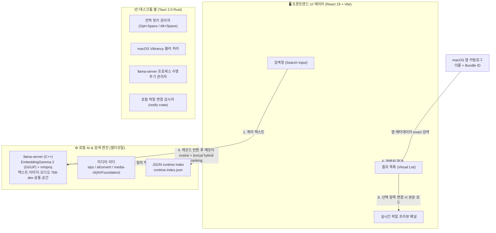

# System Architecture Specification

## 1. 아키텍처 개요 (Overview)

Nookive는 사용자가 선택한 로컬 폴더의 문서/파일을 시맨틱(의미 기반)으로 탐색하는 Apple Silicon macOS 전용 온디바이스 데스크톱 검색 애플리케이션입니다. 현재 Windows와 Linux는 지원하지 않습니다.

화면(UI)의 자유로운 커스터마이징과 반응성을 위해 **React 19 + TypeScript + CSS Modules**를 채택하고, 가벼운 데스크톱 쉘로 **Tauri 2.0 (Rust)**을 사용합니다. 무거운 AI 연산은 C++ 기반의 **`llama-server` (EmbeddingGemma 2)** 사이드카 바이너리가 담당합니다.

---

## 2. 계층별 책임 및 분리 원칙 (Separation of Concerns)

### 2.1. 프론트엔드 레이어 (`src/`)

- **역할**: 사용자 인터랙션 수신, 키보드 네비게이션, 글래스모피즘 렌더링, 파일 프리뷰.
- **제약**: 무거운 I/O 및 파싱 로직을 직접 수행하지 않고 비동기 API/Tauri IPC로 위임.
- **통신**:
  - AI 임베딩 요청: `http://127.0.0.1:8080/v1/embeddings` (로컬 사이드카 직접 호출)
  - 파일 읽기/열기: Tauri `invoke('open_file_in_os', { path })`

### 2.2. 데스크톱 쉘 레이어 (`src-tauri/`)

- **역할**:
  1. 무테두리/투명 플로팅 윈도우 생성 및 OS 네이티브 블러(`hudWindow`, `acrylic`) 주입.
  2. 전역 단축키 등록 및 포커스 분실(`blur`) 시 윈도우 숨김(`hide`).
  3. 앱 실행 시 `llama-server` 자동 실행, 앱 종료 시 자식 프로세스 자동 파살(Kill).
  4. 로컬 파일 디스크 I/O, manifest 및 runtime JSON 인덱스 관리.
  5. macOS 앱 카탈로그(`/Applications`, `/System/Applications`, `~/Applications`)를 런타임에 수집.

### 2.3. AI 추론 및 벡터 엔진 (멀티모달)

- **모델**: `ggml-org/embeddinggemma-2-GGUF`
  - 텍스트 본체: Application Support의 `models/embeddinggemma-2-Q8_0.gguf` (≈310MB)
  - **멀티모달 인코더(mmproj)**: Application Support의 `models/mmproj-embeddinggemma-2-Q8_0.gguf` (≈555MB, 이미지·오디오)
  - DMG에는 모델을 포함하지 않으며 첫 실행 시 앱 UI에서 자동 다운로드·SHA-256 검증한다.
- **임베딩 공간**: 768차원 **단일 공간**(텍스트·이미지·오디오 상호 비교 가능)
- **서버**: `llama-server --mmproj ... -c 2048 -b 1024 -ub 1024 -np 1` (멀티모달 오디오 윈도우 기본값; 필요하면 환경변수로 하향)
- **엔드포인트**: `POST /v1/embeddings`
  - 텍스트: `{ input: "..." }`
  - 이미지: `{ input: [{ content: [{ type: "image_url", image_url: { url: "data:image/jpeg;base64,..." } }] }] }`
  - 오디오: `{ input: [{ content: [{ type: "input_audio", input_audio: { data: "<wav b64>", format: "wav" } }] }] }`
- **미디어 리더**: `sips`(이미지→JPEG 1024px), `afconvert`(오디오→16k mono WAV), `bin/media-cli`(비디오 프레임, AVFoundation)
- **저장소**: 사용자별 `index-manifest.json`과 `runtime-index.json`. 벡터 검색은 runtime 인덱스를 메모리에 로드한 뒤 프론트엔드에서 cosine similarity와 lexical 점수를 결합한다. SQLite/sqlite-vec는 현재 구현에 사용하지 않는다.

앱 카탈로그는 파일 내용 임베딩 대상이 아니다. 검색 인덱스를 처음 로드하거나 새로고침할 때
`/Applications`, `/System/Applications`, `~/Applications`를 스캔해 앱 이름과 Bundle ID를 별도
메타데이터 레코드로 exact/lexical 검색한다. 실행은 macOS `open`으로 위임한다.

### 2.4. 미디어 세그먼트 & 이동

- 인덱스에 위치 메타데이터 저장: PDF `pageNumber`, 텍스트/코드 `lineStart`, 오디오/비디오 `timestampSeconds`.
- 프론트엔드 미리보기에서 오디오/비디오는 검색된 **시점으로 자동 seek**, PDF는 해당 페이지/하이라이트 표시.

### 2.5. PDF 검색 및 미리보기 흐름

PDF 검색 결과는 목록에 표시된 뒤 `usePdfMatchScan`을 통해 백그라운드에서
페이지 단위 텍스트 검색을 수행한다. 검색 결과는 파일 ID와 검색어를 기준으로
캐시하며, 선택된 PDF를 열 때 미리보기 뷰어가 계산한 결과가 최신 상태로
목록 뱃지를 갱신한다.

PDF 미리보기는 다음 순서로 동작한다.

1. 검색어가 있으면 문서의 첫 실제 매칭 페이지를 찾는다.
2. 해당 페이지의 텍스트 좌표를 계산하고 검색어를 하이라이트한다.
3. 매칭 페이지와 전체 페이지 수를 미리보기에 표시한다.
4. 검색 텍스트 추출에 실패해도 첫 페이지의 일반 미리보기는 유지한다.

macOS에서는 Tauri command인 `render_pdf_page_native`가 Core Graphics를
사용해 페이지를 렌더링할 수 있다. 이 경로는 macOS 전용이며, 텍스트 레이어가
없는 PDF는 페이지 미리보기는 가능하지만 검색 매칭 페이지와 하이라이트를
제공하지 못할 수 있다.
