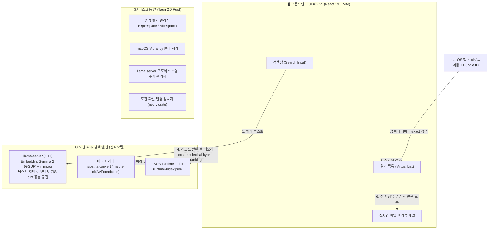

# System Architecture Specification

## 1. 아키텍처 개요 (Overview)

Nookive는 사용자가 선택한 로컬 폴더의 문서/파일을 시맨틱(의미 기반)으로 탐색하는 Apple Silicon macOS 전용 온디바이스 데스크톱 검색 애플리케이션입니다. 현재 Windows와 Linux는 지원하지 않습니다.

화면(UI)의 자유로운 커스터마이징과 반응성을 위해 **React 19 + TypeScript + CSS Modules**를 채택하고, 가벼운 데스크톱 쉘로 **Tauri 2.0 (Rust)**을 사용합니다. 무거운 AI 연산은 C++ 기반의 **`llama-server` (EmbeddingGemma 2)** 사이드카 바이너리가 담당합니다.

---

## 2. 계층별 책임 및 분리 원칙 (Separation of Concerns)

### 2.1. 프론트엔드 레이어 (`src/`)

- **역할**: 사용자 인터랙션 수신, 키보드 네비게이션, 글래스모피즘 렌더링, 파일 프리뷰.
- **제약**: 무거운 I/O 및 파싱 로직을 직접 수행하지 않고 비동기 API/Tauri IPC로 위임.
- **통신**:
  - AI 임베딩 요청: `http://127.0.0.1:8080/v1/embeddings` (로컬 사이드카 직접 호출)
  - 파일 읽기/열기: Tauri `invoke('open_file_in_os', { path })`

### 2.2. 데스크톱 쉘 레이어 (`src-tauri/`)

- **역할**:
  1. 무테두리/투명 플로팅 윈도우 생성 및 OS 네이티브 블러(`hudWindow`, `acrylic`) 주입.
  2. 전역 단축키 등록 및 포커스 분실(`blur`) 시 윈도우 숨김(`hide`).
  3. 앱 실행 시 `llama-server` 자동 실행, 앱 종료 시 자식 프로세스 자동 파살(Kill).
  4. 로컬 파일 디스크 I/O, manifest 및 runtime JSON 인덱스 관리.
  5. macOS 앱 카탈로그(`/Applications`, `/System/Applications`, `~/Applications`)를 런타임에 수집.

### 2.3. AI 추론 및 벡터 엔진 (멀티모달)

- **모델**: `ggml-org/embeddinggemma-2-GGUF`
  - 텍스트 본체: Application Support의 `models/embeddinggemma-2-Q8_0.gguf` (≈310MB)
  - **멀티모달 인코더(mmproj)**: Application Support의 `models/mmproj-embeddinggemma-2-Q8_0.gguf` (≈555MB, 이미지·오디오)
  - DMG에는 모델을 포함하지 않으며 첫 실행 시 앱 UI에서 자동 다운로드·SHA-256 검증한다.
- **임베딩 공간**: 768차원 **단일 공간**(텍스트·이미지·오디오 상호 비교 가능)
- **서버**: `llama-server --mmproj ... -c 2048 -b 1024 -ub 1024 -np 1` (멀티모달 오디오 윈도우 기본값; 필요하면 환경변수로 하향)
- **엔드포인트**: `POST /v1/embeddings`
  - 텍스트: `{ input: "..." }`
  - 이미지: `{ input: [{ content: [{ type: "image_url", image_url: { url: "data:image/jpeg;base64,..." } }] }] }`
  - 오디오: `{ input: [{ content: [{ type: "input_audio", input_audio: { data: "<wav b64>", format: "wav" } }] }] }`
- **미디어 리더**: `sips`(이미지→JPEG 1024px), `afconvert`(오디오→16k mono WAV), `bin/media-cli`(비디오 프레임, AVFoundation)
- **저장소**: 사용자별 `index-manifest.json`과 `runtime-index.json`. 벡터 검색은 runtime 인덱스를 메모리에 로드한 뒤 프론트엔드에서 cosine similarity와 lexical 점수를 결합한다. SQLite/sqlite-vec는 현재 구현에 사용하지 않는다.

앱 카탈로그는 파일 내용 임베딩 대상이 아니다. 검색 인덱스를 처음 로드하거나 새로고침할 때
`/Applications`, `/System/Applications`, `~/Applications`를 스캔해 앱 이름과 Bundle ID를 별도
메타데이터 레코드로 exact/lexical 검색한다. 실행은 macOS `open`으로 위임한다.
표시 이름은 앱 번들의 현지화 이름(`InfoPlist.strings` / `.loctable`)을 Nookive 화면 언어로
고르고(예: 한국어 화면에서 Notes → 메모), Info.plist의 원래 이름과 번들 파일명은 검색용 이름으로
함께 둔다. 설정에서 화면 언어를 바꾸면 앱 목록을 다시 불러온다.

앱 설치·삭제는 재시작 없이 반영한다(`app_watcher.rs`). `/Applications`와 `~/Applications`를 감시하되
(`/System/Applications`는 macOS 업데이트 때만 바뀌어 제외), 번들 안쪽 파일 이벤트는 앱 업데이트이므로 무시하고
번들 경로 자체나 번들을 담을 수 있는 폴더(3단계 깊이까지)의 변경만 받는다. 2초 동안 조용해지면 Info.plist를 읽지 않는
가벼운 번들 경로 목록을 이전과 비교해, 실제로 달라졌을 때만 `applications-changed`를 보낸다. 검색 창은
`searchClient.refreshApplications()`로 앱 레코드만 바꾸고 문서·폴더 인덱스는 다시 읽지 않는다. 휴지통으로 옮긴 앱도
같은 방식으로 빠진다.

### 2.4. 미디어 세그먼트 & 이동

- 인덱스에 위치 메타데이터 저장: PDF `pageNumber`, 텍스트/코드 `lineStart`, 오디오/비디오 `timestampSeconds`.
- 프론트엔드 미리보기에서 오디오/비디오는 검색된 **시점으로 자동 seek**, PDF는 해당 페이지/하이라이트 표시.

### 2.5. PDF 검색 및 미리보기 흐름

PDF 검색 결과는 목록에 표시된 뒤 `usePdfMatchScan`을 통해 백그라운드에서
페이지 단위 텍스트 검색을 수행한다. 검색 결과는 파일 ID와 검색어를 기준으로
캐시하며(검색이 고른 페이지도 키에 포함), 선택된 PDF를 열 때 미리보기 뷰어가 계산한 결과가 최신 상태로
목록 뱃지를 갱신한다.

PDF 미리보기는 다음 순서로 동작한다.

1. 검색어가 있으면 불용어와 한 글자 단어를 뺀 검색어 단어가 가장 많이 들어 있는 페이지를 찾는다.
   단어 수가 같으면 검색이 고른 청크의 페이지(`bestChunk.pageNumber`)를, 그것도 아니면 앞 페이지를 고른다.
2. 해당 페이지의 텍스트 좌표를 계산하고 검색어를 하이라이트한다.
3. 매칭 페이지와 전체 페이지 수를 미리보기에 표시한다.
4. 검색 텍스트 추출에 실패해도 첫 페이지의 일반 미리보기는 유지한다.

macOS에서는 Tauri command인 `render_pdf_page_native`가 Core Graphics를
사용해 페이지를 렌더링할 수 있다. 이 경로는 macOS 전용이며, 텍스트 레이어가
없는 PDF는 페이지 미리보기는 가능하지만 검색 매칭 페이지와 하이라이트를
제공하지 못할 수 있다.

### 2.6. 검색 개인화

같은 검색어로 실제로 연 결과를 기억해 다음 검색에서 조금 올린다. 계산은
`src/features/search/services/feedback.ts`(I/O 없는 순수 함수), 저장은 Rust
`search_feedback.rs`가 맡는다.

- 기록 시점: 로컬 결과를 연 경우만(Enter, 하단 열기 버튼, 더블클릭, 미리보기 열기 버튼).
  네 경로 모두 `App.tsx`의 `handleOpenFile`을 지난다. 선택 이동·미리보기·경로 복사·Finder
  표시·웹 검색은 기록하지 않는다.
- 키: 화면 결과를 만든 `settledQuery`를 NFC·소문자·공백 정리로 정규화한 값 + `file.path`
  (앱은 `.app` 경로). 파일을 옮기거나 이름을 바꾸면 기록이 이어지지 않는다.
- 강도: 열 때마다 `s = s × 2^(−경과/30일) + 1`, 같은 쌍은 10분 안에 다시 열어도 한 번으로 센다.
  배율은 `1 + 0.15 × (1 − 2^(−s))`로 최대 +15%다.
- 적용: `rankResults`에서 게이트를 통과한(`rankScore > 0`) 결과의 `rankScore`에만 곱한다.
  `similarityScore`는 그대로라 섹션 순서는 바뀌지 않고 섹션 안의 순서만 바뀐다.
- 저장: `app_data_dir/search-feedback.json`(임시 파일 후 rename), 최근 사용 순 최대 2,000개.
  저장에 실패해도 검색은 메모리 기록으로 계속된다.
- 초기화: 설정의 "검색 개인화" 카드. 파일을 지우고 `search-feedback-reset` 이벤트로 검색 창의
  메모리 기록도 비운다. 검색 데이터 초기화와는 따로 동작한다.

### 2.7. 코드 검색 (파일 이름/경로, 내용)

코드 파일은 임베딩하지 않는다(2.4 참고). 대신 검색 폴더(manifest의 `roots`)의 코드 파일을 이름/경로로
찾고(`code_search.rs`), 내용은 줄 단위 SQLite 색인으로 찾는다(`code_index.rs`). 일반 검색에 섞이지 않으므로
폴더별 허용 대신 설정의 전체 스위치(기본 켜짐) 하나로 켜고 끈다.

- 목록: `ignore` 크레이트로 켠 폴더를 훑는다. `.gitignore`(하위 폴더 포함)와 `.git/info/exclude`를 따르고,
  숨김·의존성·빌드 폴더와 비밀/키·lock·minified 파일은 `file_class.rs`의 제외 규칙으로 거른다.
  내용은 읽지 않고 경로·이름·크기·수정 시각만 메모리에 둔다(최대 20만 개).
- 갱신: 코드 모드에 들어올 때 목록이 30초보다 오래됐으면 다시 훑는다. 검색 폴더가 바뀌면 다음 검색에서 다시 훑는다.
  파일 감시가 코드 파일 변경을 알리면 나이와 관계없이 다시 훑는다(아래 색인 갱신).
- 순위: 이름 정확 일치(확장자 제외 포함) > 이름 시작 > 이름 포함 > 모든 단어가 이름에 > 경로 일치.
  검색어의 모든 단어가 이름이나 경로에 있어야 한다. 같은 단계에서는 얕은 경로가 먼저다.
  파일 이름은 NFC·소문자로 맞춰 비교한다.
- 진입: 검색 모드 목록(`src/features/search/utils/searchModes.ts`)의 한 모드다. Tab은 전체 → 각 모드 →
  전체 순으로 돌고 Shift+Tab은 반대로 돈다. 빈 입력에서 Backspace나 Esc는 전체 검색으로 돌아간다.
  `code:` 접두어로도 들어간다. 설정에서 꺼진 모드는 순환과 접두어에서 빠진다.
  ⌘/⌃/⌥ 조합과 IME 조합 중인 Tab은 건드리지 않는다. 코드 모드에서는 일반 결과와 웹 폴백을 쓰지 않는다.
  모드를 바꿔도 새 모드의 검색이 끝날 때까지 이전 결과(또는 빈 결과 안내, 웹 폴백)를 그대로 두고 한 번에 바꾼다.
  어떤 모드의 결과가 화면에 있는지는 `settledSearchMode`로 판단한다.
- 칩: 아이콘과 번역된 짧은 라벨(`modes.<id>.chip`)을 보여준다. 접두어는 언어와 관계없이 영어로 둔다.
  하단 Tab 안내는 다음 모드 이름(`modes.<id>.name`)을 보여주며, 전체 검색에서는 검색 폴더에 코드 파일이
  있을 때만 보인다. 새 모드는 `SEARCH_MODES`, 칩 아이콘, 번역 키를 더해 추가한다.
- 미리보기: 선택한 코드 파일(1MB 이하)을 에디터처럼 보여준다. 테마와 관계없이 VS Code Dark+ 색의 어두운 면에
  줄 번호와 highlight.js 문법 강조를 쓴다(`codeHighlight.ts`, 언어 모듈은 처음 볼 때 따로 불러온다).
  에디터처럼 줄바꿈하지 않고 가로로 스크롤하며, 줄 번호는 왼쪽에 고정된다. 검색어가 오른쪽에 가려 있으면 보이도록 가로로 스크롤한다.
  앞 400줄을 보여주고, 내용 결과면 마지막 일치 줄 아래 200줄까지 보여준다. 가장 좋은 줄은 배경과 함께 강조해
  가운데로 스크롤하고, 같은 파일의 다른 일치 줄은 줄 번호와 검색어만 표시한다.
- 내용 색인: 앱 데이터 폴더의 `code-index.sqlite`(WAL). `code_files`(경로·크기·수정 시각·건너뜀)와
  FTS5 `code_lines`(trigram, `detail=none`)를 둔다. rowid는 `파일 id << 24 | 줄 번호`라서 파일 하나의 줄을
  rowid 범위로 지운다. 3글자 미만 줄은 저장하지 않고, 줄은 500자까지만 저장한다. 1MB 초과·NUL 바이트·
  5,000자 넘는 줄이 있는(압축·생성된) 파일은 내용을 건너뛴다.
- 색인 갱신: 코드 모드에 들어올 때 `sync_code_index`가 백그라운드 스레드에서 목록과 색인을 맞춘다.
  크기·수정 시각이 같은 파일은 다시 읽지 않고, 목록에서 사라진 파일은 지운다. 200개 파일마다 커밋해
  색인 중에도 검색은 지금까지 커밋된 내용을 본다. 시작과 끝에 `code-index-state` 이벤트를 보내고,
  검색 창은 끝났을 때 코드 파일 수를 다시 세고 코드 검색을 다시 실행한다.
- 실시간 갱신: 검색 폴더 감시(`index/watcher.rs`)가 문서·미디어 변경과 별도로 코드 파일 변경을 골라내고
  (`is_code_change`: 같은 제외 폴더·파일 규칙), 2초 동안 조용해지면 `sync_after_file_changes`가 목록을 다시
  훑고 색인을 맞춘다. 파일 하나 수정과 브랜치 전환 같은 대량 변경을 같은 방식으로 처리하므로 변경 수 기준값이나
  이벤트별 처리가 없다(코드 파일 1만9천 개 목록 다시 훑기 0.2초, 변경 없는 1만 개 비교 5ms). 색인 중에 변경이
  들어오면 끝난 직후 한 번 더 맞춘다. 코드 검색 스위치가 켜져 있고(검색 창이 `set_code_search_enabled`로
  알린다) 색인 파일이 이미 있을 때만 동작한다.
- 미리 만들기: 스위치가 켜져 있는데 색인 파일이 없으면 앱 시작 10초 뒤 백그라운드에서 만든다. 코드 파일이 없으면
  빈 파일도 만들지 않는다. 그 밖에는 코드 모드에 들어갈 때 만든다(검색 데이터 초기화 직후 등).
- 상태: `get_code_index_status`가 파일 수, 건너뛴 파일 수, 크기(db + wal), 마지막 갱신 시각(파일 수정 시각)을
  색인 파일에서 바로 읽는다. 설정의 검색 상태 카드가 코드 파일 수, 건너뛴 파일 안내, 통합 마지막 갱신 시각에 쓴다. 사용자에게 보이는 문구는 "색인" 대신 "검색 데이터"라고 쓴다.
- 내용 검색: 위치 정보가 없어 구 검색을 쓸 수 없으므로 검색어 단어를 3글자 조각으로 나눠 모두 포함하는
  줄을 후보(최대 5,000줄)로 받고, 소문자로 실제 포함 여부를 확인한다. 순위는 식별자 경계의 단어 일치 >
  검색어 전체 포함 > 모든 단어 포함이고, 같은 단계에서는 얕은 경로, 줄 번호 순이다. 결과는 파일당 하나(최대 50개)로
  묶고 가장 좋은 줄을 보여주며, 같은 파일의 다른 일치 줄(최대 20줄)은 `chunks`에 담아 목록 뱃지(`L52 +2`)와
  미리보기 강조에 쓴다. 3글자 미만 검색어는 이름/경로만 찾는다. 이름 결과(최대 20개)가 앞에 오고 내용 결과가
  뒤에 온다. 이름으로도 찾은 파일은 따로 넣지 않고 이름 결과에 일치 줄을 붙인다.
- 크기: 공개 Rust 크레이트 소스 1만 개(199MB, 생성된 대형 파일 포함)를 release 빌드로 색인하면 34초,
  색인 파일 488MB였다. 변경이 없을 때 다시 맞추는 데 5ms, 검색은 10~90ms였다.
- 초기화: 검색 데이터 초기화(`reset_index`)가 `code-index.sqlite`도 지운다. 스위치를 끄면 갱신만 멈춘다.
- 열기: 코드 결과는 `open_code_file`(`editors.rs`)이 설정한 에디터에서 일치한 줄로 연다. 이름/경로 결과는 줄 없이 연다.
  에디터는 셸 PATH 대신 번들 ID로 찾는다(NSWorkspace). VS Code·Cursor·Windsurf(Devin)는 번들 안 CLI
  (`-g <경로>:<줄>`; URL 스킴은 열 때마다 확인 창을 띄워 쓰지 않는다), Zed·Sublime Text는 번들 안 CLI
  (`<경로>:<줄>`), JetBrains IDE는 번들 안 실행 파일
  (`--line N <경로>`), Xcode는 `/usr/bin/xed --line N`을 셸 없이 실행한다. 검색 폴더 안의 실제 코드 파일
  (실제 경로 기준)만 넘기고, 에디터가 없거나 실행에 실패하면 기본 앱으로 연다. 설정은 localStorage
  (`nookive.codeEditor`: `auto` = 처음 찾은 에디터, `default` = 기본 앱, 또는 에디터 id)이고, 코드 결과의
  열기 버튼과 하단 Enter 안내는 열릴 에디터 이름(Finder의 앱 이름)을 보여준다.
