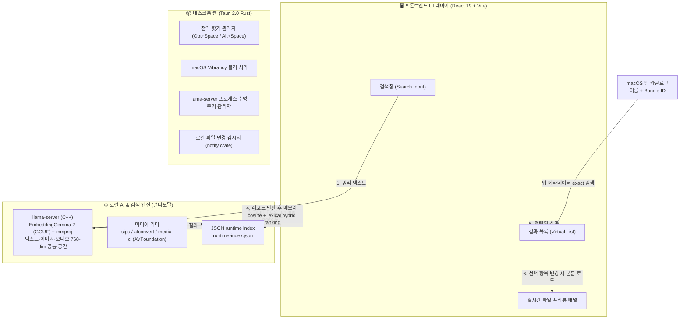

# System Architecture Specification

## 1. 아키텍처 개요 (Overview)

Nookive는 사용자가 선택한 로컬 폴더의 문서/파일을 시맨틱(의미 기반)으로 탐색하는 Apple Silicon macOS 전용 온디바이스 데스크톱 검색 애플리케이션입니다. 현재 Windows와 Linux는 지원하지 않습니다.

화면(UI)의 자유로운 커스터마이징과 반응성을 위해 **React 19 + TypeScript + CSS Modules**를 채택하고, 가벼운 데스크톱 쉘로 **Tauri 2.0 (Rust)**을 사용합니다. 무거운 AI 연산은 C++ 기반의 **`llama-server` (EmbeddingGemma 2)** 사이드카 바이너리가 담당합니다.

---

## 2. 계층별 책임 및 분리 원칙 (Separation of Concerns)

### 2.1. 프론트엔드 레이어 (`src/`)

- **역할**: 사용자 인터랙션 수신, 키보드 네비게이션, 글래스모피즘 렌더링, 파일 프리뷰.
- **제약**: 무거운 I/O 및 파싱 로직을 직접 수행하지 않고 비동기 API/Tauri IPC로 위임.
- **통신**:
  - AI 임베딩 요청: `http://127.0.0.1:8080/v1/embeddings` (로컬 사이드카 직접 호출)
  - 파일 읽기/열기: Tauri `invoke('open_file_in_os', { path })`

### 2.2. 데스크톱 쉘 레이어 (`src-tauri/`)

- **역할**:
  1. 무테두리/투명 플로팅 윈도우 생성 및 OS 네이티브 블러(`hudWindow`, `acrylic`) 주입.
  2. 전역 단축키 등록 및 포커스 분실(`blur`) 시 윈도우 숨김(`hide`).
  3. 앱 실행 시 `llama-server` 자동 실행, 앱 종료 시 자식 프로세스 자동 파살(Kill).
  4. 로컬 파일 디스크 I/O, manifest 및 runtime JSON 인덱스 관리.
  5. macOS 앱 카탈로그(`/Applications`, `/System/Applications`, `~/Applications`)를 런타임에 수집.
- **스레드**: Tauri v2는 `async`가 아닌 커맨드를 메인 스레드에서 실행해, 오래 걸리는 커맨드가 그동안 화면을 멈춘다. 앱·폴더 목록
  (`list_applications`, `list_indexed_folders`)과 아이콘(`get_application_icon`, `get_folder_icon`, `plutil`·`sips`를 실행)은
  `async` 커맨드로 두고 `spawn_blocking`에서 실행한다. (알파벳 한 글자로 앱이 많이 나올 때 아이콘을 처음 받는 동안 화면이
  잠깐 멈추던 문제) 파일 읽기(`read_file_bytes`, 미리보기와 색인이 쓴다), PDF 페이지 그리기(`render_pdf_page_native`,
  CoreGraphics), 검색 데이터 읽기(`load_runtime_index`)와 네트워크 커맨드(날씨, 환율, 웹 자동완성)도 같은 방식이다.
  상태를 바꾸는 커맨드(`sync_index_manifest`, `reset_index`, `save_search_feedback` 등)는 메인 스레드에서 차례로 실행되는 덕분에
  순서가 지켜지므로, 잠금 없이 옮기지 않는다. 창·트레이를 다루는 커맨드는 AppKit이 메인 스레드를 요구해 그대로 둔다.

### 2.3. AI 추론 및 벡터 엔진 (멀티모달)

- **모델**: `ggml-org/embeddinggemma-2-GGUF`
  - 텍스트 본체: Application Support의 `models/embeddinggemma-2-Q8_0.gguf` (≈310MB)
  - **멀티모달 인코더(mmproj)**: Application Support의 `models/mmproj-embeddinggemma-2-Q8_0.gguf` (≈555MB, 이미지·오디오)
  - DMG에는 모델을 포함하지 않으며 첫 실행 시 앱 UI에서 자동 다운로드·SHA-256 검증한다.
- **임베딩 공간**: 768차원 **단일 공간**(텍스트·이미지·오디오 상호 비교 가능)
- **서버**: `llama-server --mmproj ... -c 2048 -b 1024 -ub 1024 -np 1` (멀티모달 오디오 윈도우 기본값; 필요하면 환경변수로 하향)
- **엔드포인트**: `POST /v1/embeddings`
  - 텍스트: `{ input: "..." }`
  - 이미지: `{ input: [{ content: [{ type: "image_url", image_url: { url: "data:image/jpeg;base64,..." } }] }] }`
  - 오디오: `{ input: [{ content: [{ type: "input_audio", input_audio: { data: "<wav b64>", format: "wav" } }] }] }`
- **미디어 리더**: `sips`(이미지→JPEG 1024px), `afconvert`(오디오→16k mono WAV), `bin/media-cli`(비디오 프레임, AVFoundation)
- **저장소**: 사용자별 `index-manifest.json`과 `runtime-index.json`. 벡터 검색은 runtime 인덱스를 메모리에 로드한 뒤 프론트엔드에서 cosine similarity와 lexical 점수를 결합한다. SQLite/sqlite-vec는 현재 구현에 사용하지 않는다.

앱 카탈로그는 파일 내용 임베딩 대상이 아니다. 검색 인덱스를 처음 로드하거나 새로고침할 때
`/Applications`, `/System/Applications`, `~/Applications`를 스캔해 앱 이름과 Bundle ID를 별도
메타데이터 레코드로 exact/lexical 검색한다. 실행은 macOS `open`으로 위임한다.
표시 이름은 앱 번들의 현지화 이름(`InfoPlist.strings` / `.loctable`)을 Nookive 화면 언어로
고르고(예: 한국어 화면에서 Notes → 메모), Info.plist의 원래 이름과 번들 파일명은 검색용 이름으로
함께 둔다. 설정에서 화면 언어를 바꾸면 앱 목록을 다시 불러온다.

앱 설치·삭제는 재시작 없이 반영한다(`app_watcher.rs`). `/Applications`와 `~/Applications`를 감시하되
(`/System/Applications`는 macOS 업데이트 때만 바뀌어 제외), 번들 안쪽 파일 이벤트는 앱 업데이트이므로 무시하고
번들 경로 자체나 번들을 담을 수 있는 폴더(3단계 깊이까지)의 변경만 받는다. 2초 동안 조용해지면 Info.plist를 읽지 않는
가벼운 번들 경로 목록을 이전과 비교해, 실제로 달라졌을 때만 `applications-changed`를 보낸다. 검색 창은
`searchClient.refreshApplications()`로 앱 레코드만 바꾸고 문서·폴더 인덱스는 다시 읽지 않는다. 휴지통으로 옮긴 앱도
같은 방식으로 빠진다.

### 2.4. 미디어 세그먼트 & 이동

- 인덱스에 위치 메타데이터 저장: PDF `pageNumber`, 텍스트/코드 `lineStart`, 오디오/비디오 `timestampSeconds`.
- 프론트엔드 미리보기에서 오디오/비디오는 검색된 **시점으로 자동 seek**, PDF는 해당 페이지/하이라이트 표시.

### 2.5. PDF 검색 및 미리보기 흐름

PDF 검색 결과는 목록에 표시된 뒤 `usePdfMatchScan`을 통해 백그라운드에서
페이지 단위 텍스트 검색을 수행한다. 검색 결과는 파일 ID와 검색어를 기준으로
캐시하며(검색이 고른 페이지도 키에 포함), 선택된 PDF를 열 때 미리보기 뷰어가 계산한 결과가 최신 상태로
목록 뱃지를 갱신한다.

PDF 미리보기는 다음 순서로 동작한다.

1. 검색어가 있으면 불용어와 한 글자 단어를 뺀 검색어 단어가 가장 많이 들어 있는 페이지를 찾는다.
   단어 수가 같으면 검색이 고른 청크의 페이지(`bestChunk.pageNumber`)를, 그것도 아니면 앞 페이지를 고른다.
2. 해당 페이지의 텍스트 좌표를 계산하고 검색어를 하이라이트한다.
3. 매칭 페이지와 전체 페이지 수를 미리보기에 표시한다.
4. 검색 텍스트 추출에 실패해도 첫 페이지의 일반 미리보기는 유지한다.

macOS에서는 Tauri command인 `render_pdf_page_native`가 Core Graphics를
사용해 페이지를 렌더링할 수 있다. 이 경로는 macOS 전용이며, 텍스트 레이어가
없는 PDF는 페이지 미리보기는 가능하지만 검색 매칭 페이지와 하이라이트를
제공하지 못할 수 있다.

### 2.6. 검색 개인화

같은 검색어로 실제로 연 결과를 기억해 다음 검색에서 조금 올린다. 계산은
`src/features/search/services/feedback.ts`(I/O 없는 순수 함수), 저장은 Rust
`search_feedback.rs`가 맡는다.

- 기록 시점: 로컬 결과를 연 경우만(Enter, 하단 열기 버튼, 더블클릭, 미리보기 열기 버튼).
  네 경로 모두 `App.tsx`의 `handleOpenFile`을 지난다. 선택 이동·미리보기·경로 복사·Finder
  표시·웹 검색은 기록하지 않는다.
- 키: 화면 결과를 만든 `settledQuery`를 NFC·소문자·공백 정리로 정규화한 값 + `file.path`
  (앱은 `.app` 경로). 파일을 옮기거나 이름을 바꾸면 기록이 이어지지 않는다.
- 강도: 열 때마다 `s = s × 2^(−경과/30일) + 1`, 같은 쌍은 10분 안에 다시 열어도 한 번으로 센다.
  배율은 `1 + 0.15 × (1 − 2^(−s))`로 최대 +15%다.
- 적용: `rankResults`에서 게이트를 통과한(`rankScore > 0`) 결과의 `rankScore`에만 곱한다.
  `similarityScore`는 그대로라 섹션 순서는 바뀌지 않고 섹션 안의 순서만 바뀐다.
- 저장: `app_data_dir/search-feedback.json`(임시 파일 후 rename), 최근 사용 순 최대 2,000개.
  저장에 실패해도 검색은 메모리 기록으로 계속된다.
- 초기화: 설정의 "검색 개인화" 카드. 파일을 지우고 `search-feedback-reset` 이벤트로 검색 창의
  메모리 기록도 비운다. 검색 데이터 초기화와는 따로 동작한다.

### 2.6.0. 시스템 설정 화면

시스템 설정의 화면(`개인정보 보호 및 보안`, `블루투스`, `디스플레이`)을 앱처럼 찾아 결과의 "설정" 묶음(앱 다음)에 보이고, Enter나
미리보기의 열기 버튼으로 시스템 설정의 그 화면을 바로 연다(`settings_panes.rs`).

- 목록은 직접 적지 않는다. macOS 13+의 설정 화면은 `/System/Library/ExtensionKit/Extensions/` 안의 설정 확장(`.appex`,
  `EXExtensionPointIdentifier` = `com.apple.Settings.extension.ui`)이고, 다른 회사의 설정 화면은 `/Library/PreferencePanes`,
  `~/Library/PreferencePanes`의 `.prefPane`이다. 앱 목록(`list_applications`)에 같은 모양(`kind: application`)으로 함께 담고,
  확장자(`appex`, `prefPane`)로 "설정" 묶음을 가른다(`getFileSection`, `isSettingsPane`). 앱처럼 앱 감시가 다시 불러올 때 함께 읽는다.
- 이름: 앱 이름과 같은 현지화 이름(`InfoPlist.loctable`, `<언어>.lproj`)을 화면 언어로 보이고, 영어 이름(예: "Privacy & Security")과
  사람이 읽는 번들 이름(예: "Wi-Fi")을 다른 이름으로 둬 어느 화면 언어에서도 영어로 찾게 한다. 내부 이름("…SettingsExtension",
  "_macOS")만 있는 확장은 시스템 설정 목록에 보이지 않는 내부용이라 빼고, 설정 확장의 파일명은 검색 이름으로 쓰지 않는다. 이름의
  줄바꿈 없는 하이픈("Wi‑Fi", U+2011)은 키보드의 "-"로 비교하고(`nfcName`), 앱·설정 이름은 하이픈을 뺀 이름도
  검색 이름으로 둬 `wifi`로도 찾는다(`searchableNames`).
- 아이콘: 설정 확장은 아이콘 파일 없이 macOS 내장 아이콘 종류(`CFBundleIcons.ISGraphicIconConfiguration.ISTypeIdentifier`, 예:
  `com.apple.graphic-icon.privacy`)만 적어 두므로 NSWorkspace로 그 종류의 아이콘을 받는다. `.prefPane`은 `NSPrefPaneIconFile`.
- 열기(`open_settings_pane`): 위 폴더 안의 설정 화면만 받는다. 설정 확장은 Info.plist의 번들 ID로
  `x-apple.systempreferences:<번들 ID>`를 열고(번들 ID 글자만 허용), 열지 못하면 시스템 설정 첫 화면을 연다. `.prefPane`은 `open`한다.
- 미리보기: 앱과 같은 모양이되 종류 문구와 배지는 "시스템 설정"·SETTINGS로 보이고, Finder에서 보기 버튼은 두지 않는다. 인라인
  자동완성도 설정 화면 이름으로 이어진다(`개인정보` → "개인정보 보호 및 보안").
- 설정 화면 안의 항목으로 바로 가기("카메라 권한" 등)와 macOS 12 이하는 아직 지원하지 않는다.

### 2.6.1. 앱 인라인 자동완성

전체 검색에서 첫 번째 결과가 앱이고 이름(현지화 이름, 원래 이름, 번들 이름)이 검색어로 시작하면, 입력창에 나머지
이름을 이어 보여주고 오른쪽에 앱 아이콘을 둔다(`src/features/search/utils/inlineCompletion.ts`). 예: `c` → `c`laude — 열기.

- 완성은 항상 Enter가 여는 결과(첫 줄)와 같다. 검색이 끝났으면 첫 결과로만 완성하고, 첫 결과가 앞부분 일치 앱이
  아니면 보여주지 않는다. 검색이 끝나기 전(0.14초 디바운스)에는 직전 검색의 첫 결과가 아직 맞으면 그 앱을, 아니면
  메모리의 앱 목록(`searchClient.applications()`)을 실제 검색과 같은 점수(`rankQuery`, 이미 불러온 개인화 기록
  `feedbackClient.peekBoost` 포함)로 정렬해 이름이 맞는 첫 앱을 써서 첫 키 입력부터 보인다. 그래서 검색이 끝난 뒤
  첫 결과와 어긋나 바뀌는 일이 없다. 이때 Enter를 누르면 보이는 앱을 연다.
- 입력한 글자는 입력한 대소문자 그대로 두고 나머지만 이름에서 가져온다. 다른 이름으로 일치하면(`No` → Notes)
  안내에 화면 이름을 보인다(— 메모 열기). 이름은 NFC로 맞추고 모든 공백 문자를 일반
  공백으로 바꿔 비교한다(`nfcName`). macOS 앱 이름에는 줄바꿈 없는 공백(U+00A0)이 들어 있기도 해서("나의 찾기") 키보드로 친
  공백과 맞지 않으면 "나의 "에서 완성이 끊긴다. 앱 검색 점수의 이름 비교도 같은 함수를 쓴다.
- 입력값은 바꾸지 않고 같은 글꼴로 입력창 위에 겹쳐 그린다(입력한 부분은 투명). IME 입력·되돌리기·선택에 영향이
  없다. →로 완성을 받아들인다(Tab은 모드 전환 키). IME 조합 중, 커서가 끝에 있지 않거나 선택이 있을 때, 입력이
  칸을 넘칠 때, 웹·코드 모드에서는 보이지 않는다. 설정의 검색 방식에서 끌 수 있다(기본 켜짐).
- 방향키로 선택이 첫 줄을 떠나면 숨기고, 첫 줄로 돌아오면 다시 보인다. 선택한 앱 이름으로 바꿔 보여주지 않는다:
  다른 결과는 이름이 검색어로 시작하지 않는 일이 많고, →로 받아들이면 검색이 다시 돌아 목록 위치를 잃는다.

### 2.6.2. 계산기·단위 변환

전체 검색에서 검색어가 계산식이나 단위 변환이면 결과 줄을 목록 맨 위(선택 번호 0)에 두고, 선택하면 미리보기 자리에
결과를 크게 보여준다(`src/features/search/utils/calculator.ts`). 로컬 결과는 그 아래에 한 칸씩 밀려 함께 보인다.

- 계산: `+ - * / ^`, `×`·`÷`, 괄호, 소수, 단항 부호, 뒤에 붙는 `%`, `15% of 80`, 천 단위 쉼표(`1,200`). eval 없이 재귀 하강
  파서로 계산한다. 거듭제곱은 오른쪽 결합이고 단항 부호보다 먼저 묶인다(`-2^2 = -4`).
- 단위: 길이, 무게, 온도, 넓이(평 포함), 부피, 용량(KB/MB/GB는 1000, KiB/MiB/GiB는 1024 단위), 시간, 속도.
  `10 km in mi`, `10km to mi`, `100f → c`와 한국어 `10킬로미터를 마일로`를 받는다. 환율은 환율 변환(2.6.6)이 따로 답한다.
- 계산이 아닌 입력에는 결과를 내지 않는다: 숫자만, 연산자 없는 괄호, 날짜·전화번호 모양(`2026-11-03`, `11/3/2026`,
  `010-1234-5678`), 버전(`0.1.4`), 일반 단어, 0으로 나누기처럼 유한하지 않은 결과.
- Enter·⌘C·더블클릭은 결과를 복사하고(단위와 천 단위 구분 없이, 화면 언어의 소수점) 창은 닫지 않은 채 1.5초 동안
  "복사됨"을 보여준다. 결과는 화면 언어의 숫자 형식으로 유효 숫자 10자리까지 보이고, 입력 해석(`10 km → mi`)을 함께
  작게 보인다. 계산 결과가 있으면 인라인 자동완성과 웹 폴백은 보이지 않는다. 웹·코드 모드에서는 쓰지 않는다.
- 미리보기는 다른 미리보기처럼 왼쪽 위에 결과(크게)와 입력 해석을 두고, 파일 미리보기의 열기 버튼과 같은 아래 왼쪽에 복사 버튼과
  macOS 계산기를 여는 버튼을 둔다. 계산기에는 식을 넘길 공개 방법(URL 스킴, AppleScript
  사전)이 없어 앱만 연다. 키 입력을 흉내 내려면 손쉬운 사용 권한이 필요해 쓰지 않는다.

### 2.6.3. 날씨

전체 검색에서 검색어가 날씨를 물으면(`수원 날씨`, `구로 내일 날씨`, `오늘 날씨`, `Paris weather`, `東京の天気`) 계산 결과와
같은 자리(선택 번호 0)에 날씨 줄을 두고, 선택하면 미리보기 자리에 예보를 보여준다. 계산 결과가 있으면 날씨는 보지 않는다.

- 검색어 해석(`weatherQuery.ts`, 네트워크 없음): 9개 화면 언어의 날씨 단어를 화면 언어와 관계없이 받는다. 한국어·
  중국어·일본어는 날씨 단어가 끝에 와야 하고("날씨 메모"는 날씨가 아님), 라틴 문자 언어는 앞에 와도 된다("weather
  london"). 기간은 오늘·내일·모레·이번 주·주말을 읽는다. 날씨 단어만 입력하면(`날씨`, `Weather`) macOS 날씨 앱을 여는
  입력으로 보고 날씨 줄을 내지 않는다. `tempo`·`tiempo`·`clima`처럼 다른 뜻이 흔한 단어와 숫자·기호가 섞인 입력도 받지
  않는다.
- 지명(`weather.rs`의 `weather_places`, `weatherPlaces.ts`): 키가 필요 없는 두 서비스에 따로 묻는다. Photon
  (OpenStreetMap, 지역 종류를 시·구·군·동네로 거름)은 행정구역을 잘 찾고("종로" → 종로구), Open-Meteo 지명 검색
  (GeoNames)은 다른 언어로 쓴 큰 도시를 잘 찾는다("파리" → Paris). 이름이 맞는 행정구역 > 이름이 맞는 큰 도시 > 이름
  뒤에 번호가 붙은 행정구역 > 별칭으로 찾은 큰 도시 > 이름이 같은 동네 순서로 고르고, 같은 단계에서는 기본 지역의 나라, macOS에서
  고른 지역, 화면 언어의 나라 순서로 먼저 둔다. "부산 해운대"처럼 앞에 상위 지역을 붙이면 마지막 단어를 이름으로, 앞 단어를 상위 지역으로
  본다. 맞는 곳이 없으면 날씨 줄을 내지 않는다. 나라별 지명 표는 두지 않는다. 고른 지명은 localStorage
  (`nookive.weatherPlaceCache`, 100개)에 두어 같은 지명은 다시 묻지 않는다. 같은 이름의 작은 곳이 먼저 잡힐 수 있어
  (`성수` → 진안군 성수면) 화면에 상위 지역을 함께 보여주고, 더 자세히 쓰면(`성수동`) 바로잡힌다.
- 속도: 서버가 유럽에 있어 처음 찾는 지명은 Photon 약 2.5초, Open-Meteo 지명 검색·예보 각 약 1초가 걸린다(2026-11 측정).
  Rust는 연결을 다시 쓰는 reqwest 클라이언트 하나로 요청해 두 번째 요청부터 TLS 연결 시간(0.3~0.8초)을 아낀다.
  검색 창에서는 먼저 오는 Open-Meteo 답이 이름이 그대로 맞는 수도·도청 소재지(PPLC, PPLA)나 인구 100만 이상 도시면
  Photon을 기다리지 않는다(`isUnambiguousCity`, "파리", "도쿄"). 같은 이름이 여러 곳인 한국의 구·군은 Photon을 기다린다.
  설정의 지역 고르기는 후보를 모두 보여야 하므로 두 답을 모두 기다린다.
- 예보(`weather_forecast`, `weatherForecast.ts`): Open-Meteo 예보 API에서 현재 날씨, 48시간, 16일을 받는다. 좌표는
  소수 둘째 자리까지만 보내고, 좌표별로 15분 동안 메모리에 둔다. 날짜와 시각은 그 지역의 현지 시각(`timezone=auto`)이다.
  WMO 날씨 코드는 8개 상태(맑음, 구름 조금, 흐림, 안개, 이슬비, 비, 눈, 뇌우)로 묶는다. 온도는 섭씨로 받는다.
- 단위와 시각 형식: 웹뷰의 `navigator.language`는 선호 언어 목록이라 사는 지역을 알 수 없으므로, Rust `get_system_locale`
  (`system_locale.rs`)이 macOS 언어 및 지역 설정(`AppleLocale`의 지역, `AppleTemperatureUnit`, `AppleMetricUnits`,
  `AppleICUForce24HourTime`·`AppleICUForce12HourTime`)을 읽는다(`src/utils/systemLocale.ts`, 창마다 한 번). 사용자가 직접 고른
  온도 단위·측정 단위·24시간 표시를 먼저 따르고, 고르지 않은 값은 사는 지역의 관례를 쓴다(미국 등은 화씨·mph, 시각은 앱
  언어와 지역을 합친 로케일의 기본값: 한국어·한국은 "오후 1시", 독일어·독일은 "13 Uhr"). 영어를 쓰며 한국에 살면 섭씨다.
- 다른 시간대 지역의 날씨를 보면(예보의 `utc_offset_seconds`가 Mac과 다르면) 시간별 예보 위에 "현지 시각 (GMT+1)"을 작게
  보인다.
- 기간: 기간이 없거나 오늘·이번 주면 지금 날씨와 24시간, 내일·모레는 그날의 날씨와 시간별, 주말은 다가오는 토·일을
  보여준다. 미리보기의 일별 목록은 7일(주말이 그 뒤면 거기까지)이며 물어본 날을 강조한다.
- 지역 없이 물으면 설정의 기본 지역을 쓴다(`nookive.weatherLocation`). 기본 지역이 없으면 요청 없이 안내 줄을 보이고,
  Enter는 설정의 검색 방식 분류를 연다(`open_settings_window`, 분류는 localStorage `nookive.settingsTabRequest`로 전한다).
  위치 권한이나 IP 위치는 쓰지 않는다.
- 요청은 검색어 전체가 날씨 형태와 맞을 때만 0.25초 디바운스 뒤에 보낸다. Rust가 고정된 주소(photon.komoot.io,
  geocoding-api.open-meteo.com, api.open-meteo.com)로만 요청을 만든다. 보내는 것은 지명 또는 좌표뿐이고, 검색어 전체·
  파일·사용자 위치는 보내지 않는다. 한 서비스가 실패하면 다른 서비스의 결과만 쓰고, 둘 다 실패하거나 오프라인이면 짧은
  오류 줄을 보인다. 로컬 결과에는 영향이 없다.
- 검색어가 날씨 형태가 되면 첫 답을 기다리지 않고 바로 "○○ 날씨 불러오는 중" 줄을 같은 자리에 둔다. 웹 폴백이 떴다가
  날씨로 바뀌지 않게 하려는 것이다. 빈 "검색 중" 화면이 아니라 최종 모양의 한 줄이며, 아래 로컬 결과는 그대로 보인다.
  날씨 질문을 고치는 동안(`수원 내일 날씨` → `서울 내일 날씨`)에는 새 답이 올 때까지 이전 답을 보이고, 지명을 찾지 못한 답이
  오면 그때 줄을 없앤다. 날씨가 아닌 검색어가 되면 이전 답은 버린다. 답을 기다리는 동안 인라인 자동완성은 보이지 않는다.
  날씨 줄이 생기거나 사라질 때 아래 결과를 고르고 있었다면 같은 결과가 계속 선택되도록 선택 번호를 한 칸 옮긴다.
- 열기와 설정: Enter와 더블클릭은 고른 검색 엔진으로 검색어를 열어 자세한 예보를 보여준다. 기본 지역 안내 줄의 Enter는 설정을
  연다(위). 설정에서 끌 수 있다(`nookive.weatherEnabled`, 기본 켜짐). Open-Meteo 무료 API는 비상업용이다.
- 결과 줄: 계산 결과 줄과 같은 줄 스타일(`AnswerRow.module.css`)을 쓰고, 날씨 아이콘은 칩 배경 없이 아이콘 자리를 채운다.
  "불러오는 중" 줄의 제목은 결과 값이 아니므로 작고 가볍게 쓴다.
- 미리보기 머리: 지명과 상위 지역, 물어본 기간, 큰 아이콘과 기온을 보인다. 지금 날씨면 체감·습도·바람을, 하루·여러 날이면
  "최고 / 최저"와 강수 확률을 보인다.
- 시간별 예보: 스크롤바 없이 양 끝의 화살표 버튼으로 한 화면씩 넘기고(트랙패드 가로 스크롤도 된다), 버튼은 넘길 곳이 없으면
  부드럽게 사라진다. 넘길 곳이 있는 쪽 끝은 마스크로 흐리게 하고, 넘길 때는 시간 칸 단위로 맞춰 흐림에 가려지던 끝 칸이 새
  화면에서는 흐림 바깥에 오게 한다. 시각은 위의 시각 형식을 따르되 "오전/오후"(dayPeriod)는 작게 쓴다. 자정 칸은 시각 대신 그날
  이름(`내일`, `목`)을 조금 진하게 쓰고, 그 칸 앞을 넓게 띄운 틈 가운데에 가는 세로선을 그어 날짜가 바뀐 곳을 알린다. 강수
  확률은 모든 시간에 보이고(칸 모양을 같게), 0%는 흐리게 쓴다.
- 일별 예보: 7일(주말이 그 뒤면 거기까지)이며 물어본 날을 강조한다. 강수 확률 앞의 물방울은 확률에 따라 세 단계로 채우고
  (30% 미만 빈 물방울, 30~59% 아래 절반, 60% 이상 가득, 0%는 숨김), 물방울은 한 세로줄에 두고 숫자는 오른쪽 끝을 맞춘다.
  최저·최고 기온 사이에는 그 주 범위 안에서의 그날 범위를 막대로 보여준다(열 이름 없이 읽히게). 최저·막대·최고는 한 묶음으로
  다른 열보다 가깝게 둔다. 퍼센트는 언어 관례를 따른다(프랑스어·독일어·스페인어는 "41 %").
- 미리보기 아래: 파일 미리보기의 열기 버튼과 같은 아래 왼쪽에 "웹에서 보기" 버튼, 그 오른쪽에 출처(Open-Meteo,
  © OpenStreetMap). 버튼 글자는 줄을 바꾸지 않고, 자리가 모자라면 출처가 "·" 단위로만 줄을 바꾼다.
- 아이콘: Meteocons(`@bybas/weather-icons`, MIT)의 색이 있는 fill 아이콘이다(`weatherIcons.ts`).
  - 결과 줄과 미리보기 머리의 큰 아이콘만 원래 애니메이션을 둔다. macOS 웹뷰(WKWebView)는 `` 안의 SVG 애니메이션을 첫
    장면에서 멈추므로 큰 아이콘은 인라인 SVG로 넣고, 아이콘마다 겹치는 내부 그라데이션 id에는 `useId`로 만든 접두어를 붙인다.
    시스템의 "동작 줄이기"가 켜져 있으면 큰 아이콘도 정지 그림을 쓴다.
  - 시간별·일별의 작은 아이콘은 SMIL 애니메이션 요소를 지운 정지 그림을 data URL 이미지로 그린다. 빗방울·눈송이의 처음 위치가
    구름 뒤에 걸쳐 비가 거의 보이지 않으므로, 떨어지는 이동을 60% 지점으로 옮겨 구름 아래에 두고 빗줄기·눈송이를 굵게 그린다.
  - 라이트 모드에서는 흰 구름·옅은 회색 안개 색을 진하게, 다크 모드에서는 짙은 빗방울 색을 밝게 바꾼 그림을 쓴다. 화면 모드는
    `data-theme`(수동 선택)과 시스템 설정을 따라 바로 바뀐다.

### 2.6.4. 세계 시각

전체 검색에서 다른 곳의 지금 시각을 묻거나(`뉴욕 시간`, `time in London`, `東京 今何時`) 시간대를 바꾸면(`3pm PST in KST`,
`뉴욕 오후 3시는 서울 몇 시`) 계산 결과·날씨와 같은 자리(선택 번호 0)에 시각 줄을 두고, 선택하면 미리보기에 시간대 비교를
보여준다. 계산 결과나 날씨 질문이 있으면 세계 시각은 보지 않는다.

- 검색어 해석(`timeQuery.ts`, 네트워크 없음): 지금 시각은 지명 + 시각 단어(한국어 `시간`·`몇 시`·`현재 시간`, 일본어 `今何時`·
  `時間`, 중국어 `现在几点`·`時間`, 영어 `time in`·`X time`, 독일어 `Uhrzeit`, 프랑스어 `heure à`, 스페인어 `hora en`, 포르투갈어
  `hora em`·`horário em`)다. 시간대 바꾸기는 시각(`3pm`, `15:00`, `오후 3시 30분`, `午後3時`, `下午3点`, `15h30`, `15 Uhr`)과
  출발·도착 시간대이며, `in`·`to`·`→`와 한국어 조사(`~는 ~ 몇 시`, `~를 ~로`)로 나눈다. 출발이나 도착이 없으면 이 Mac의 시간대다.
  시각 단어만(`시간`, `time`), 시각만(`오후 3시`), 숫자 뒤의 `시간`(`3시간`), 일정 메모처럼 보이는 입력(`오후 3시 회의`,
  `meeting 3pm`), 지명이 아닌 흔한 말(`근무 시간`, `screen time`)은 받지 않는다.
- 시간대: 흔한 약어(KST, JST, PST/PDT, EST/EDT, CET, UTC 등)는 IANA 시간대로, `UTC+9`·`GMT-5:30`은 고정 오프셋으로 바로 정해
  네트워크를 쓰지 않는다. 약어는 대문자로 쓴 경우만 받는다(UTC·GMT는 소문자도). 지명은 날씨와 같은 지명 검색과 캐시를
  쓰고(`resolvePlaceWithTimezone`), Open-Meteo 결과는 IANA 시간대를 함께 주므로 그대로 쓴다. Photon 결과는 시간대가 없어
  좌표로 한 번 묻고(Rust `place_timezone`, Open-Meteo에 날씨 변수 없이 `timezone=auto`) 지명 캐시에 함께 저장한다.
- 계산(`worldTime.ts`): IANA 시간대는 Intl로 그 순간의 오프셋을 구해 일광 절약 시간을 따른다. 시간대 바꾸기는 출발지의 오늘
  그 시각을 순간으로 바꾼 뒤(오프셋을 한 번 더 확인해 서머타임이 바뀌는 날도 맞춤) 도착지 시각으로 보인다. 날짜가 다르면
  지금 시각은 "내일/어제", 시간대 바꾸기는 "다음 날/전날"을 붙인다.
- 결과 줄: 지금 시각이면 그곳 시각, 지명·상위 지역, 내 시간과의 차이("14시간 느림")를, 시간대 바꾸기면 도착 시각과
  "뉴욕 오후 3:00 → 서울"을 보인다. 시각 형식은 날씨와 같이 macOS 24시간 설정을 따르고, 지금 시각은 15초마다 다시 그린다.
  Enter·⌘C·더블클릭은 시각(날짜가 다르면 그 표시 포함)을 복사한다.
- 미리보기: 큰 시각, 날짜, GMT 오프셋, 내 시간과의 차이, 두 시간대를 한 시간씩 나란히 보인 6줄 비교표
  (두 곳 모두 9~18시인 줄을 칠해 회의 시간을 고르기 쉽게), 파일 미리보기의 열기 버튼과 같은 아래 왼쪽의 복사 버튼. 스크롤 없이 한
  화면에 들어오게 둔다.
- 지명이 있으면 날씨처럼 0.25초 디바운스 뒤 "○○ 시각 불러오는 중" 줄을 두고, 질문을 고치는 동안에는 이전 답을 보이며, 지명을
  찾지 못하면 줄을 없앤다. 보내는 것은 지명(그리고 Photon 결과의 좌표)뿐이다. 설정의 검색 방식에서 끌 수 있다
  (`nookive.worldTimeEnabled`, 기본 켜짐).

### 2.6.5. 날짜 계산

전체 검색에서 날짜를 물으면 계산 결과와 같은 자리(선택 번호 0)에 답 줄을 두고, 선택하면 미리보기에 날짜 정보를 보여준다.
네트워크 없이 Mac의 오늘 날짜로 계산한다(`dateQuery.ts`). 계산 결과가 있으면 날짜 계산은 보지 않고, 날짜 답이 있으면 날씨·세계
시각은 보지 않는다.

- 질문: 오늘에서 옮기기(`100일 후`, `3 weeks ago`, `in 2 months`, `100日後`, `3天前`, `vor 10 Tagen`), 날짜에서 옮기기
  (`2026-12-25 + 30 days`, `2 weeks before Christmas`, `2026-03-01부터 100일 후`), 남은 날(`크리스마스까지`,
  `days until 2026-12-25`, `クリスマスまで`, `距离圣诞节还有几天`), 두 날짜 사이(`2026-12-25 - 2026-11-04`,
  `2026-01-01부터 오늘까지`, `days between … and …`), 요일(`2026-12-25 무슨 요일`, `what day is December 25, 2026`,
  `2026年12月25日は何曜日`, `quel jour est le …`).
- 한국식 기념일: `2026-03-01부터 100일`(뒤에 "후"가 없음)은 시작일을 1일로 세어 99일 뒤를 답하고, 미리보기에 그렇게 센다고 밝힌다.
- 날짜 읽기: ISO(`2026-12-25`, `2026.12.25`), 한국어(`2026년 12월 25일`, `12월 25일`), 일본어·중국어(`12月25日`), 9개 언어의
  달 이름(`Dec 25`, `25 décembre`, `25 de diciembre`, `25. Dezember`, Intl에서 만든다), 오늘·내일·어제와 같은 말, 해마다 같은
  기념일(크리스마스, 새해 등). 숫자만 쓴 `12/25`·`25/12`의 순서는 macOS 지역의 날짜 형식을 따른다(`isDayFirst`).
- 연도가 없으면 올해로 보되, "~까지"는 지났으면 내년으로 본다. 달·해를 더해 없는 날이 되면 그 달의 마지막 날로 맞춘다
  (1월 31일 + 1개월 = 2월 28일, 2028-02-29 + 1년 = 2029-02-28).
- 날짜만, 기간만(`100일`, `3 weeks`), 오늘만, 버전·전화번호, 연도 없는 빼기(`1999 - 2000`)는 받지 않는다. 계산기는 연도까지
  쓴 날짜가 들어간 식을 계산하지 않아(`2026-12-25 - 2026-11-04`) 날짜 계산이 답한다.
- 결과 줄: 날짜 답은 요일까지 쓴 긴 날짜와 계산 과정("오늘 + 100일"), 일수 답은 "51일 남음"·"51일"과 시작·끝 날짜.
  미리보기는 날짜, ISO, 오늘과의 거리(주·일), 또는 주로 본 길이와 시작·끝 날짜를 보인다. Enter·⌘C·더블클릭·복사 버튼(파일 미리보기의
  열기 버튼과 같은 아래 왼쪽)은 보이는 답을 복사한다. 오늘 날짜는 창이 다시 보일 때 다시 읽어 자정을 넘겨도 맞게 한다.

### 2.6.6. 환율 변환

계산기와 같은 자리(선택 번호 0)에 환율 변환 줄을 두고, 선택하면 미리보기에 환율 정보를 보여준다. 계산 결과가 있으면 보지 않고,
환율 변환이 있으면 날짜 계산·날씨·세계 시각은 보지 않는다.

- 검색어 해석(`currencyQuery.ts`, 네트워크 없음): 금액 + 출발 통화 + 도착 통화. `in`·`to`·`→`·`=`, 한국어 조사(`50달러 원화로`,
  `1000엔은 원으로`, `100달러를 원화로 환산`), 일본어(`100ドルは円で`), 중국어(`100美元等于多少人民币`, `换成`, `兑`)로 나눈다.
  통화는 ISO 코드(대문자, 또는 흔한 코드는 소문자 `usd`도), 기호(`$`, `€`, `£`, `¥`, `₩`, `C$`, `NT$` 등), 9개 언어의 흔한
  이름(달러, 원화, 엔, 유로, 위안, dollar, euro, 円, ドル, 美元, 人民币, 台币 등)이다. 금액은 천 단위 쉼표, 소수, 한국어 단위
  (`1만`, `3만5천`), `3k`, 계산식(`(12+8) usd in eur`, 계산기로 계산)을 받는다.
- `$`, `dollar`, `달러`처럼 여러 나라가 쓰는 말은 macOS 지역의 달러(캐나다 CAD, 호주 AUD, 대만 TWD 등, 없으면 USD), `¥`는 중국이면
  CNY 그 밖에는 JPY, `元`은 대만이면 TWD, `peso`는 지역의 페소로 본다. 도착 통화가 없거나(`100 usd`) 같은 통화끼리면 답하지 않는다.
- 환율(`currency.rs`의 `currency_rates`, `currencyClient.ts`): ExchangeRate-API의 공개 엔드포인트(키 없음, 하루 한 번 갱신, 출처
  표시 필요)에서 미국 달러 기준 환율표 하나(166개 통화, TWD·VND 포함)만 받는다. 어떤 통화를 바꾸는지는 보내지 않고 두 통화 사이
  환율은 표로 계산한다. 표는 localStorage(`nookive.currencyRates`)에 두고 서버가 알려 준 다음 갱신 시각(없으면 12시간) 전에는
  다시 받지 않는다. 받지 못하면 저장한 표를 쓰고 미리보기에 오래된 표라고 알린다. 표가 아예 없으면 짧은 오류 줄을 보인다.
- 결과 줄: `= ₩134,412`(도착 통화의 형식과 소수 자리), 설명 `$100.00 → KRW · 1 USD = 1,344.13 KRW`. Enter·⌘C·더블클릭은
  계산기처럼 숫자만(통화 기호·천 단위 구분 없이, 화면 언어의 소수점) 복사한다.
- 미리보기: 바꾼 금액, 두 방향 환율, 환율표 기준 시각, 참고용 환율이라는 안내, 아래 왼쪽의 복사·웹에서 보기 버튼과 오른쪽의 출처
  링크("Rates By Exchange Rate API", 이용 조건의 문구). 설정의 검색 방식에서 끌 수 있다(`nookive.currencyEnabled`, 기본 켜짐).

### 2.7. 코드 검색 (파일 이름/경로, 내용)

코드 파일은 임베딩하지 않는다(2.4 참고). 대신 검색 폴더(manifest의 `roots`)의 코드 파일을 이름/경로로
찾고(`code_search.rs`), 내용은 줄 단위 SQLite 색인으로 찾는다(`code_index.rs`). 일반 검색에 섞이지 않으므로
폴더별 허용 대신 설정의 전체 스위치(기본 켜짐) 하나로 켜고 끈다.

- 목록: `ignore` 크레이트로 켠 폴더를 훑는다. `.gitignore`(하위 폴더 포함)와 `.git/info/exclude`를 따르고,
  숨김·의존성·빌드 폴더와 비밀/키·lock·minified 파일은 `file_class.rs`의 제외 규칙으로 거른다.
  내용은 읽지 않고 경로·이름·크기·수정 시각만 메모리에 둔다(최대 20만 개).
- 갱신: 코드 모드에 들어올 때 목록이 30초보다 오래됐으면 다시 훑는다. 검색 폴더가 바뀌면 다음 검색에서 다시 훑는다.
  파일 감시가 코드 파일 변경을 알리면 나이와 관계없이 다시 훑는다(아래 색인 갱신).
- 순위: 이름 정확 일치(확장자 제외 포함) > 이름 시작 > 이름 포함 > 모든 단어가 이름에 > 경로 일치.
  검색어의 모든 단어가 이름이나 경로에 있어야 한다. 같은 단계에서는 얕은 경로가 먼저다.
  파일 이름은 NFC·소문자로 맞춰 비교한다.
- 진입: 검색 모드 목록(`src/features/search/utils/searchModes.ts`)의 한 모드다. Tab은 전체 → 웹 → 코드 →
  전체 순으로 돌고 Shift+Tab은 반대로 돈다(누구나 쓰는 웹을 개발자만 쓰는 코드보다 앞에 둔다). 빈 입력에서
  Backspace나 Esc는 전체 검색으로 돌아간다. `web:`·`code:` 접두어로도 들어간다. 설정에서 꺼진 모드(웹 검색,
  코드 검색 스위치)와 검색 폴더에 코드 파일이 없을 때의 코드 모드는 순환과 접두어에서 빠진다.
- 웹 모드: 로컬 파일은 찾지 않고, 로컬 결과와 관계없이 검색 엔진 자동완성 목록(웹 폴백과 같은 목록)을 보여준다.
  Enter는 검색어나 고른 제안으로 웹 검색을 연다. 전체 검색에서 결과가 없을 때의 자동 웹 폴백은 그대로 둔다.
  웹 검색 설정은 다른 창의 변경도 storage 이벤트로 따라간다(`subscribeWebSearchEnabled`).
- 검색 엔진: Google, Bing, DuckDuckGo, Brave Search, Ecosia, Naver, Baidu 중 설정에서 고른다
  (`nookive.webSearchEngine`, `src/utils/webSearchEngines.ts`). 고르지 않았으면 화면 언어의 기본 엔진을 쓴다: 간체
  중국어는 Baidu(중국 본토에서는 Google에 접속할 수 없다), 나머지는 Google. 이름은 고유 명사로 두되 자국 브랜드는
  그 언어의 공식 이름으로 보인다(한국어 네이버, 중국어 百度). 메뉴는 Google, 지금 언어의 지역 엔진, 나머지 순서다. 검색 결과 주소는 프론트엔드가, 자동완성 요청은 Rust `web_suggest`가 같은 엔진
  id 목록으로만 만든다(임의 주소 요청 불가). 자동완성 응답은 OpenSearch 형식(Google·Bing·DuckDuckGo·Brave·Ecosia·Baidu)과
  Naver 형식을 파싱하고, 캐시 키에 엔진과 언어를 함께 넣는다.
  ⌘/⌃/⌥ 조합과 IME 조합 중인 Tab은 건드리지 않는다. 코드 모드에서는 일반 결과와 웹 폴백을 쓰지 않는다.
  모드를 바꿔도 새 모드의 검색이 끝날 때까지 이전 결과(또는 빈 결과 안내, 웹 폴백)를 그대로 두고 한 번에 바꾼다.
  어떤 모드의 결과가 화면에 있는지는 `settledSearchMode`로 판단한다.
- 칩: 아이콘과 번역된 짧은 라벨(`modes.<id>.chip`)을 보여준다. 접두어는 언어와 관계없이 영어로 둔다.
  하단 Tab 안내는 다음 모드 이름(`modes.<id>.name`)을 보여주며, 들어갈 모드가 없으면 숨긴다.
  새 모드는 `SEARCH_MODES`, 칩 아이콘, 번역 키를 더해 추가한다.
- 미리보기: 선택한 코드 파일(1MB 이하)을 에디터처럼 보여준다. 테마와 관계없이 VS Code Dark+ 색의 어두운 면에
  줄 번호와 highlight.js 문법 강조를 쓴다(`codeHighlight.ts`, 언어 모듈은 처음 볼 때 따로 불러온다).
  에디터처럼 줄바꿈하지 않고 가로로 스크롤하며, 줄 번호는 왼쪽에 고정된다. 검색어가 오른쪽에 가려 있으면 보이도록 가로로 스크롤한다.
  앞 400줄을 보여주고, 내용 결과면 마지막 일치 줄 아래 200줄까지 보여준다. 가장 좋은 줄은 배경과 함께 강조해
  가운데로 스크롤하고, 같은 파일의 다른 일치 줄은 줄 번호와 검색어만 표시한다.
- 내용 색인: 앱 데이터 폴더의 `code-index.sqlite`(WAL). `code_files`(경로·크기·수정 시각·건너뜀)와
  FTS5 `code_lines`(trigram, `detail=none`)를 둔다. rowid는 `파일 id << 24 | 줄 번호`라서 파일 하나의 줄을
  rowid 범위로 지운다. 3글자 미만 줄은 저장하지 않고, 줄은 500자까지만 저장한다. 1MB 초과·NUL 바이트·
  5,000자 넘는 줄이 있는(압축·생성된) 파일은 내용을 건너뛴다.
- 색인 갱신: 코드 모드에 들어올 때 `sync_code_index`가 백그라운드 스레드에서 목록과 색인을 맞춘다.
  크기·수정 시각이 같은 파일은 다시 읽지 않고, 목록에서 사라진 파일은 지운다. 200개 파일마다 커밋해
  색인 중에도 검색은 지금까지 커밋된 내용을 본다. 시작과 끝에 `code-index-state` 이벤트를 보내고,
  검색 창은 끝났을 때 코드 파일 수를 다시 세고 코드 검색을 다시 실행한다.
- 실시간 갱신: 검색 폴더 감시(`index/watcher.rs`)가 문서·미디어 변경과 별도로 코드 파일 변경을 골라내고
  (`is_code_change`: 같은 제외 폴더·파일 규칙), 2초 동안 조용해지면 `sync_after_file_changes`가 목록을 다시
  훑고 색인을 맞춘다. 파일 하나 수정과 브랜치 전환 같은 대량 변경을 같은 방식으로 처리하므로 변경 수 기준값이나
  이벤트별 처리가 없다(코드 파일 1만9천 개 목록 다시 훑기 0.2초, 변경 없는 1만 개 비교 5ms). 색인 중에 변경이
  들어오면 끝난 직후 한 번 더 맞춘다. 코드 검색 스위치가 켜져 있고(검색 창이 `set_code_search_enabled`로
  알린다) 색인 파일이 이미 있을 때만 동작한다.
- 미리 만들기: 스위치가 켜져 있는데 색인 파일이 없으면 앱 시작 10초 뒤 백그라운드에서 만든다. 코드 파일이 없으면
  빈 파일도 만들지 않는다. 그 밖에는 코드 모드에 들어갈 때 만든다(검색 데이터 초기화 직후 등).
- 상태: `get_code_index_status`가 파일 수, 건너뛴 파일 수, 크기(db + wal), 마지막 갱신 시각(파일 수정 시각)을
  색인 파일에서 바로 읽는다. 설정의 검색 상태 카드가 코드 파일 수, 건너뛴 파일 안내, 통합 마지막 갱신 시각에 쓴다. 사용자에게 보이는 문구는 "색인" 대신 "검색 데이터"라고 쓴다.
- 내용 검색: 위치 정보가 없어 구 검색을 쓸 수 없으므로 검색어 단어를 3글자 조각으로 나눠 모두 포함하는
  줄을 후보(최대 5,000줄)로 받고, 소문자로 실제 포함 여부를 확인한다. 순위는 식별자 경계의 단어 일치 >
  검색어 전체 포함 > 모든 단어 포함이고, 같은 단계에서는 얕은 경로, 줄 번호 순이다. 결과는 파일당 하나(최대 50개)로
  묶고 가장 좋은 줄을 보여주며, 같은 파일의 다른 일치 줄(최대 20줄)은 `chunks`에 담아 목록 뱃지(`L52 +2`)와
  미리보기 강조에 쓴다. 3글자 미만 검색어는 이름/경로만 찾는다. 이름 결과(최대 20개)가 앞에 오고 내용 결과가
  뒤에 온다. 이름으로도 찾은 파일은 따로 넣지 않고 이름 결과에 일치 줄을 붙인다.
- 크기: 공개 Rust 크레이트 소스 1만 개(199MB, 생성된 대형 파일 포함)를 release 빌드로 색인하면 34초,
  색인 파일 488MB였다. 변경이 없을 때 다시 맞추는 데 5ms, 검색은 10~90ms였다.
- 초기화: 검색 데이터 초기화(`reset_index`)가 `code-index.sqlite`도 지운다. 스위치를 끄면 갱신만 멈춘다.
- 열기: 코드 결과는 `open_code_file`(`editors.rs`)이 설정한 에디터에서 일치한 줄로 연다. 이름/경로 결과는 줄 없이 연다.
  에디터는 셸 PATH 대신 번들 ID로 찾는다(NSWorkspace). VS Code·Cursor·Windsurf(Devin)는 번들 안 CLI
  (`-g <경로>:<줄>`; URL 스킴은 열 때마다 확인 창을 띄워 쓰지 않는다), Zed·Sublime Text는 번들 안 CLI
  (`<경로>:<줄>`), JetBrains IDE는 번들 안 실행 파일
  (`--line N <경로>`), Xcode는 `/usr/bin/xed --line N`을 셸 없이 실행한다. 검색 폴더 안의 실제 코드 파일
  (실제 경로 기준)만 넘기고, 에디터가 없거나 실행에 실패하면 기본 앱으로 연다. 설정은 localStorage
  (`nookive.codeEditor`: `auto` = 처음 찾은 에디터, `default` = 기본 앱, 또는 에디터 id)이고, 코드 결과의
  열기 버튼과 하단 Enter 안내는 열릴 에디터 이름(Finder의 앱 이름)을 보여준다.
